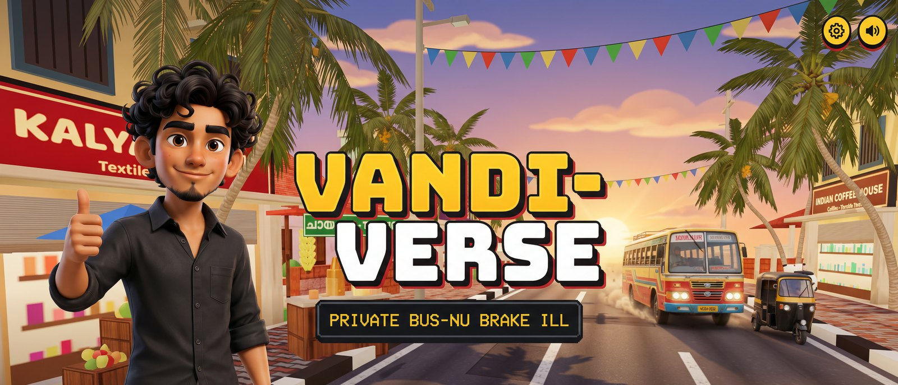
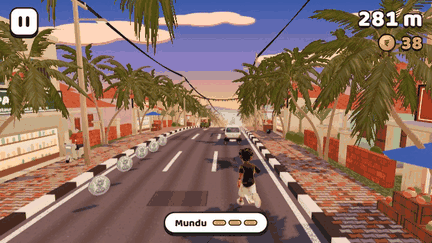

<p align="center">
  
</p>

<p align="center">
  <b>Oru chaya kudikkan irunnatha. Ippo patti pinnil, KSRTC munnil. ODU! 🏃‍♂️</b><br>
  A 3D endless runner on a Thrissur town road, in Manglish. Plays in the phone browser: no download, no install.
</p>

<p align="center">
  <a href="https://kh55wr2c-5500.inc1.devtunnels.ms/"></a>
</p>

<p align="center">
  
  
  
  
  
  
  <a href="https://github.com/zreeraggg/vandi-verse/stargazers"></a>
</p>

<p align="center"><sub>The play link is a temporary dev tunnel until the game gets a permanent home.</sub></p>

<p align="center">
  
</p>

---

## The story

You're sipping chaya at the roadside ചായക്കട. A street dog barks. The glass drops. You run.

Dodge autos, buses and falling coconuts, grab the chillara, fold your mundu to run faster, and see how far you get before the road (or the dog) gets you. Then dare your friends on WhatsApp.

## Who's on the road

| | | |
|:---:|---|---|
|  | **Auto rickshaw** | Blinker on, a short horn, and it swerves into your lane. *Njan kandilla!* |
|  | **Buses** | Private buses and KSRTCs. Most just pass with a horn that swells and fades; some charge straight at you. *KSRTC alle, mone!* |
|  | **Coconut** | The palm shakes, a shadow marks where it lands, then it rolls. *Thenga tax adachirunno?* |
|  | **Chaya** | Where every run starts. Where you'd rather be. |

Also on the road: potholes (jump), flex boards (slide), bikes and scooters, a Maruti 800 you can jump over, and the dog. Stumble twice within a few seconds and the dog catches you.

## Controls

| Phone | Keyboard | What it does |
|---|---|---|
| Swipe ← → | ← → or A D | Change lane |
| Swipe ↑ | ↑ or W | Jump |
| Swipe ↓ | ↓ or S | Slide (mid-air: drop fast, then slide) |
| Tap ×3 | Space ×3 | **Madakki kuthu**: fold the mundu. 15% faster, 30% higher jumps, but three slides and it comes loose. |
| Tap ×2 | Space ×2 | Tie a loose mundu back |
| ⏸ button | Esc or P | Pause (*Chaya break*) and resume |
| Tap | any key | Skip the tea-shop intro |

## Scoring and the leaderboard

- **Distance** is your score, in metres. The run gets faster as you go, and from 4 km the gaps between obstacles tighten.
- **Chillara**: ₹1 coins in lines and arcs (some only reachable with a jump), ₹5 coins in risky spots right beside a blocking obstacle, or up high. Quick pickups build a streak, with a shout every 50.
- **Motta puffs** 🥚: rare and legendary, only after 800 m. Worth ₹25.
- **Titles**: L Board → Pothole Pro (400 m) → KSRTC Regular (1 km) → NH66 Survivor (2.5 km) → NH66 Legend (5 km).
- **Leaderboard**: all-time best and this week's best run, shared by everyone on the same server.
- **Innathe Road**: the daily road. Same obstacles and same weather for everyone today, so scores are a fair fight.
- **WhatsApp share**: a card with your crash photo, distance and a dare for your friends.

## Thrissur touches to spot

- **Shop signs** from around town: Kalyan Silks, Kalyan Jewellers, Joyalukkas, Chemmanur, Indian Coffee House, Pathans (Round South), Hotel Bharath and Current Books.
- **Flex boards** you slide under: Thrissur Pooram, Happy Onam, Pulikkali, Vadakkumnathan temple festival, and a junction mobile-shop mega offer.
- **Buses** with THRISSUR and THRISSUR FAST boards and KL 08 number plates, plus a conductor's whistle when you restart a run.
- **The ചായക്കട**: a tea shop with a brass samovar, a glass case of pazhampori and vada, snack jars, steel tumblers, the day's paper, a blue bench and a banana bunch hanging from the roof.
- **Festival bunting**, crows, bus stops, and backwaters below the Western Ghats on the horizon.
- **Weather**: dusk and streetlights from 2 km, and on about one run in seven a monsoon shower somewhere between 600 m and 2.4 km.

## Run it locally

You need **Node.js 18 or newer**. There are no dependencies: no `npm install`.

```bash
git clone https://github.com/zreeraggg/vandi-verse.git
cd vandi-verse
node server.mjs
```

Open http://localhost:5500. The browser needs internet the first time to load three.js and the fonts from their CDNs.

| Variable | Default | Purpose |
|---|---|---|
| `PORT` | `5500` | Port to listen on |
| `HOST` | `127.0.0.1` | Address to bind (`0.0.0.0` to play from your phone on the same Wi-Fi) |
| `SCORES` | `scores.json` | Leaderboard file (created on first run) |

PowerShell: `$env:PORT=8080; node server.mjs`. If port 5500 is busy, stop VS Code Live Server first.

> Opening `index.html` directly runs the game, but the leaderboard needs `node server.mjs`.

### Tests

```bash
node test/logic.test.mjs
node test/server.test.mjs
node test/scores-function.test.mjs   # the Cloudflare leaderboard, against SQLite (Node 22.5+)
```

`tools/autoplay.js` is a dev check: inject it with Playwright and a bot plays the real game (to 3 km by default, or `localStorage['autoplay-target']`), reporting crashes, overlapping vehicles, impossible rows and draw calls. It never posts scores. With `localStorage['autoplay-capture']` set to a distance, it pauses there so you can step frames and screenshot them (that's how the GIF above was made).

## Deploy on Cloudflare Pages (with the leaderboard)

The game files are static; the leaderboard is a Pages Function (`functions/api/scores.js`) that stores scores in a Cloudflare D1 database. No build step.

1. **Database**: Cloudflare dashboard → Storage & Databases → **D1** → Create database (e.g. `vandi-verse-scores`). Open its **Console**, paste the contents of `db/schema.sql`, and run it.
2. **Pages project**: Workers & Pages → Create → **Pages** → Connect to Git → pick this repo. Framework preset **None**, build command **empty**, build output directory **`/`**. Save and deploy.
3. **Connect the database**: the Pages project → Settings → **Bindings** → Add → D1 database. Variable name **`DB`**, pick the database. Add it for Production (and Preview if you use preview deploys).
4. **Redeploy** (Deployments → latest → Retry deployment) so the binding takes effect.
5. **Check**: open `https://<your-project>.pages.dev/api/scores`. It should answer `{"top":[],"me":null,"players":0}`.

Every push to `main` deploys again on its own. `node server.mjs` still works for local play, with scores in `scores.json`.

## Tech stack

- **Engine**: [three.js](https://threejs.org/) r160 from the jsDelivr CDN, with Draco-compressed `.glb` models and a curved-world shader.
- **Code**: plain HTML, CSS and JavaScript ES modules. No framework, no bundler.
- **Audio**: Web Audio. Bus horns fade in and out as buses pass, with a Doppler pitch shift.
- **Server**: `server.mjs`, a dependency-free Node server for local play and the leaderboard API (`/api/scores`, all-time and weekly). On Cloudflare Pages the same API is `functions/api/scores.js` with a D1 (SQLite) database; both share the rules in `functions/_shared/score-rules.js`.
- **Phones first**: low graphics (1× pixels, no shadows, less rain) switch on by themselves on low-end phones and on any device that can't hold about 40 fps in a run. Scenery is merged into a few hundred draw calls, and portrait screens get their own home-screen camera.

```
index.html, style.css   page and UI
server.mjs              local static server + leaderboard API
functions/api/scores.js Cloudflare Pages leaderboard (D1)
db/schema.sql           D1 table, run once
src/main.js             game loop, input, UI, scores
src/logic.js            pure game rules (tested)
src/world.js            road, scenery, vehicles, coins
src/hero.js, character.js, dog.js   characters
src/fx.js, sounds.js, share.js      materials, audio, WhatsApp card
assets/                 models, sounds, textures
docs/art/               README banner, GIF and cartoon icons
test/, tools/           tests and the autoplay bot
```

## Roadmap

- [x] Dog chase and the tea-shop intro
- [x] Dusk, streetlights and monsoon rain
- [x] Bus horns that swell and fade as buses pass
- [x] Daily road and weekly leaderboard
- [x] Automatic low graphics for low-end phones
- [x] Bot playtests to 10 km to catch impossible obstacle layouts
- [ ] A permanent home for the game (and a real play link)
- [ ] Leaderboard checks against fake scores
- [ ] New stretches after 3 km (a temple-festival elephant, a hartal road)
- [ ] Near-miss rewards for close shaves with buses
- [ ] Missions, like "jump 5 potholes in one run"
- [ ] Sound clips for the chaya sip, glass clang, stumble and dog growl
- [ ] Mundu and shirt colour choices
- [ ] Clipping a pothole mid lane change counts as a stumble instead of a crash

## Contributing

Pull requests are welcome, especially more Thrissur.

- **A new shop sign**: add a line to `SHOPS` in `src/world.js` (name, tagline, board colour, text colour). Signs are drawn into a shared texture, so a new shop costs no extra draw calls.
- **A new flex board**: add a line to `SLOGANS` in `src/world.js`.
- **A new obstacle**: give it a size and how you pass it in `KIND` in `src/logic.js`, a model in the world's `FACTORY` in `src/world.js`, and its collision rule in `hits()` in `src/main.js`.
- **A sound**: drop an mp3 into `assets/sounds/` and point a slot at it in `src/sounds.js`. `assets/sounds/README.md` lists every slot.

Before opening a PR, run both test files and, for anything that changes obstacles, a bot run with `tools/autoplay.js`. Only add models, sounds or images you're allowed to share, and say where they came from.

## ⚠️ Copyright and credits: none of the assets are mine

**I don't own the copyright to the 3D models, sounds, music or images in this game.** They come from other creators and belong to them. This is a non-commercial hobby project. If you made something used here and want it removed or credited differently, please open an issue and I'll sort it out.

What I know about where things came from:

**3D models**
- `palm.glb`: "Coconut Palm" by evolveduk, Sketchfab (CC Attribution)
- `nut.glb`: "Kelapa Ijo (green coconut)", Sketchfab
- `auto.glb`: "Autorikshaw - Indian Tuk Tuk", Sketchfab
- `car.glb`: "Maruti 800 lowpoly free download", Sketchfab
- `dog.glb`: German Shepherd from the RSG Dogs Pack
- `hero.glb`: rigged and animated with Mixamo (including the "Jogging Stumble" and "Drinking" clips)

**Sounds** (cut from these YouTube videos)
- Bus horns: [youtu.be/TO9YCQeDoKg](https://youtu.be/TO9YCQeDoKg) (Top 10 horns, Bus Simulator Indonesia)
- Auto horn: [youtube.com/watch?v=7sKOt7gdfhU](https://www.youtube.com/watch?v=7sKOt7gdfhU)
- Coin clink: [youtube.com/watch?v=67nLQ3Zl4_s](https://www.youtube.com/watch?v=67nLQ3Zl4_s)
- Cha-ching: [youtube.com/watch?v=avmSSmRAyYo](https://www.youtube.com/watch?v=avmSSmRAyYo)
- Landing thud: [youtube.com/watch?v=9e1YXIVAG0c](https://www.youtube.com/watch?v=9e1YXIVAG0c)
- Motta puffs chime: [youtube.com/watch?v=CQ2WZ49_RjM](https://www.youtube.com/watch?v=CQ2WZ49_RjM)
- Bus air brakes: [youtube.com/watch?v=7gVbP8gd4GQ](https://www.youtube.com/watch?v=7gVbP8gd4GQ)
- Bike passing: [youtube.com/watch?v=J_Ly3mDKrqA](https://www.youtube.com/watch?v=J_Ly3mDKrqA)
- Conductor's whistle: [youtube.com/watch?v=Id558uHXejM](https://www.youtube.com/watch?v=Id558uHXejM)
- Dog barks: [youtube.com/watch?v=c13MliefckM](https://www.youtube.com/watch?v=c13MliefckM) and [youtube.com/watch?v=zcnzn3z_1TY](https://www.youtube.com/watch?v=zcnzn3z_1TY)

The other sound clips (background music, the Malayalam voice and meme lines, jump and slide sounds) and the coin and motta puffs pictures also come from other creators. `assets/sounds/README.md` lists which file plays when.

**Code libraries and fonts**
- [three.js](https://github.com/mrdoob/three.js) (MIT licence)
- Fonts from Google Fonts: Baloo Chettan 2, Bungee, Doto
- Badges by [shields.io](https://shields.io)

**Artwork**
- The hero character art, the README banner and the app icon were generated with Google Gemini.
- The gameplay GIF is recorded from the game itself.
- The small cartoon icons in `docs/art/` (auto, bus, coconut, chaya) were drawn for this project.

The shop names are a fond nod to real Thrissur places, not endorsements.

## Known limitation

The leaderboard trusts the score the browser sends, so anyone can post a fake score with a direct `POST /api/scores`, and there's no rate limit. To remove a bad entry, stop the server, delete it from `scores.json`, and start it again.
